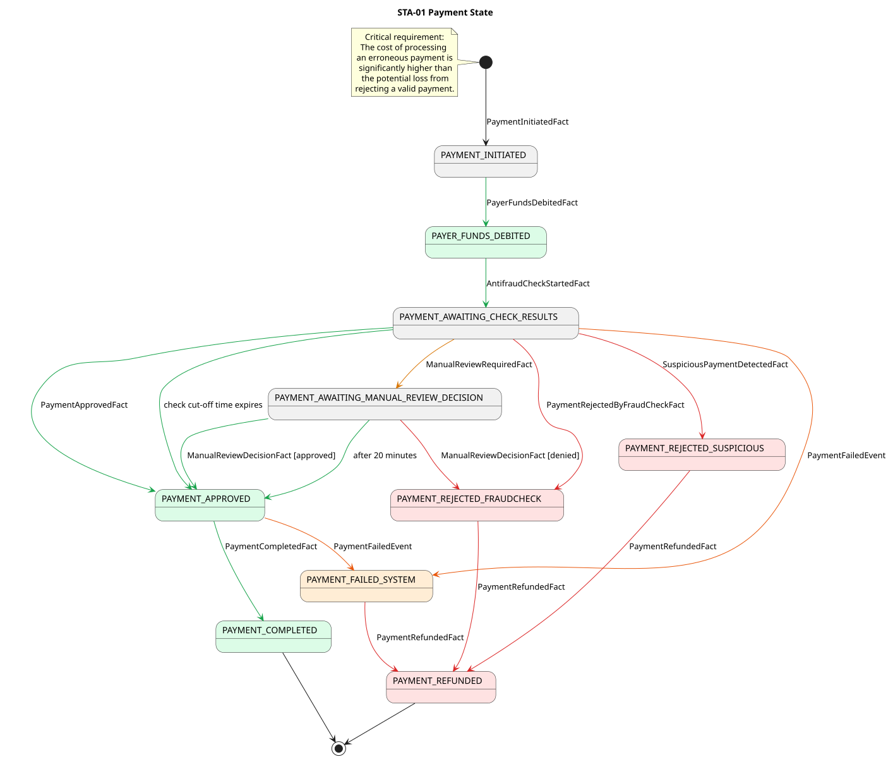

# Таблица переходов платёжной операции

STA-01 Payment State

    

<table>
  <thead>
    <tr>
      <th style="white-space: nowrap;">Исходное состояние</th>
      <th>Переходное состояние</th>
      <th>Событие</th>
    </tr>
  </thead>
  <tbody>
    <tr>
      <td style="white-space: nowrap; vertical-align: top;">Начальное состояние</td>
      <td style="white-space: nowrap;"><code>1. PAYMENT_INITIATED</code></td>
      <td><code>PaymentInitiatedFact</code></td>
    </tr>
    <tr>
      <td style="white-space: nowrap; vertical-align: top;"><code>1. PAYMENT_INITIATED</code></td>
      <td style="white-space: nowrap;"><code>2. PAYER_FUNDS_DEBITED</code></td>
      <td><code>PayerFundsDebitedFact</code></td>
    </tr>
    <tr>
      <td style="white-space: nowrap; vertical-align: top;"><code>2. PAYER_FUNDS_DEBITED</code></td>
      <td><code>3. PAYMENT_AWAITING_CHECK_RESULTS</code></td>
      <td><code>AntifraudCheckStartedFact</code></td>
    </tr>
    <tr>
      <td rowspan="6" style="white-space: nowrap; vertical-align: top;"><code>3. PAYMENT_AWAITING_CHECK_RESULTS</code></td>
      <td><code>4. PAYMENT_AWAITING_MANUAL_REVIEW_DECISION</code></td>
      <td><code>ManualReviewRequiredFact</code></td>
    </tr>
    <tr>
      <td><code>5. PAYMENT_APPROVED</code></td>
      <td><code>PaymentApprovedFact</code></td>
    </tr>
    <tr>
      <td><code>5. PAYMENT_APPROVED</code></td>
      <td>Истёк cut-off time ожидания результата проверки.</td>
    </tr>
    <tr>
      <td><code>7. PAYMENT_REJECTED_FRAUDCHECK</code></td>
      <td><code>PaymentRejectedByFraudCheckFact</code></td>
    </tr>
    <tr>
      <td><code>8. PAYMENT_REJECTED_SUSPICIOUS</code></td>
      <td><code>SuspiciousPaymentDetectedFact</code></td>
    </tr>
    <tr>
      <td><code>9. PAYMENT_FAILED_SYSTEM</code></td>
      <td><code>PaymentFailedEvent</code></td>
    </tr>
    <tr>
      <td rowspan="3" style="white-space: nowrap; vertical-align: top;"><code>4. PAYMENT_AWAITING_MANUAL_REVIEW_DECISION</code></td>
      <td><code>5. PAYMENT_APPROVED</code></td>
      <td><code>ManualReviewDecisionFact</code> — решение оператора: одобрено.</td>
    </tr>
    <tr>
      <td><code>5. PAYMENT_APPROVED</code></td>
      <td>Истекли 20 минут ожидания решения оператора.</td>
    </tr>
    <tr>
      <td><code>7. PAYMENT_REJECTED_FRAUDCHECK</code></td>
      <td><code>ManualReviewDecisionFact</code> — решение оператора: отклонено.</td>
    </tr>
    <tr>
      <td rowspan="2" style="white-space: nowrap; vertical-align: top;"><code>5. PAYMENT_APPROVED</code></td>
      <td><code>6. PAYMENT_COMPLETED</code></td>
      <td><code>PaymentCompletedFact</code></td>
    </tr>
    <tr>
      <td><code>9. PAYMENT_FAILED_SYSTEM</code></td>
      <td><code>PaymentFailedEvent</code></td>
    </tr>
    <tr>
      <td style="white-space: nowrap; vertical-align: top;"><code>7. PAYMENT_REJECTED_FRAUDCHECK</code></td>
      <td><code>10. PAYMENT_REFUNDED</code></td>
      <td><code>PaymentRefundedFact</code></td>
    </tr>
    <tr>
      <td style="white-space: nowrap; vertical-align: top;"><code>8. PAYMENT_REJECTED_SUSPICIOUS</code></td>
      <td><code>10. PAYMENT_REFUNDED</code></td>
      <td><code>PaymentRefundedFact</code></td>
    </tr>
    <tr>
      <td style="white-space: nowrap; vertical-align: top;"><code>9. PAYMENT_FAILED_SYSTEM</code></td>
      <td><code>10. PAYMENT_REFUNDED</code></td>
      <td><code>PaymentRefundedFact</code></td>
    </tr>
  </tbody>
</table>
