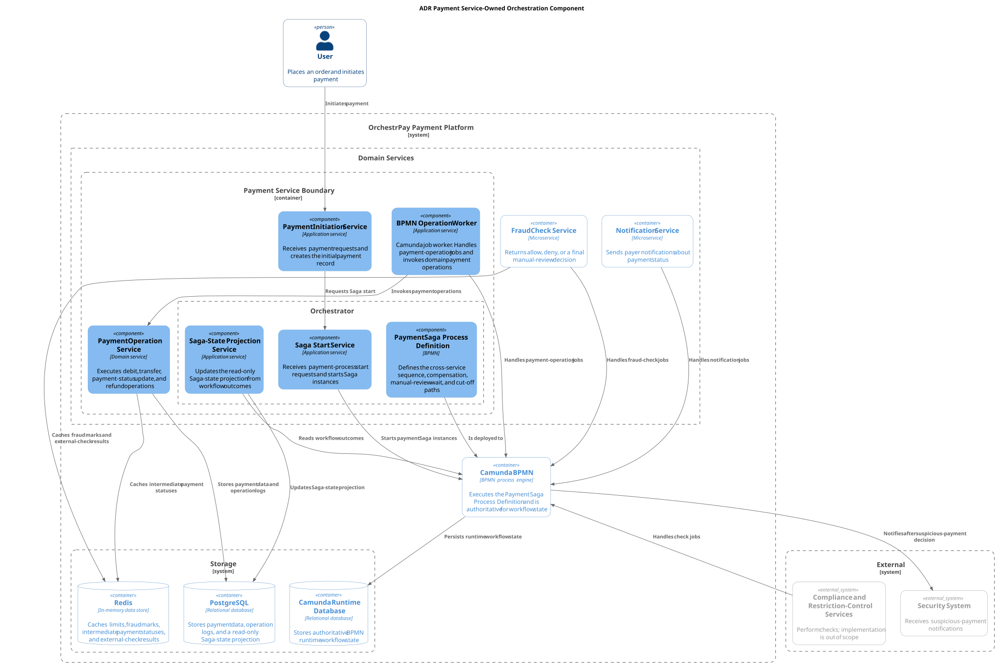
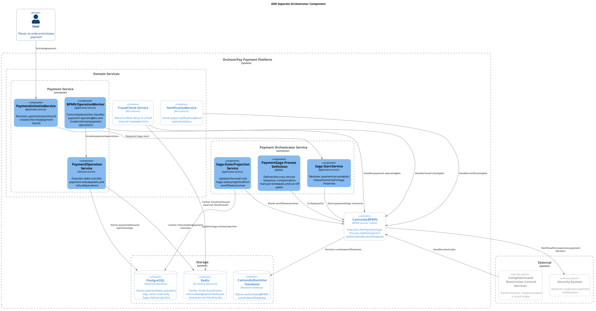

# ADR: Размещение оркестрации платёжного процесса

**Статус:** ⚠️ На рассмотрении  
**Участники:** Владелец продукта; архитектор решения  
**Дата:** 2026-10-15

## Контекст

OrchestrPay использует Camunda BPMN для выполнения Saga-оркестрации. Платёжный процесс охватывает Payment, FraudCheck, Notification, сервисы compliance-проверок и контроля ограничений, а также систему безопасности. Он включает автоматические компенсации, ручную проверку, ожидание до 20 минут и сценарий cut-off-time. [общее задание](../../engineering/blueprint/elicitation/assignments/general.assignment.md)

> [!NOTE]
> Критическое требование: стоимость ошибочного проведения платежа значительно выше потенциальных потерь от отклонения корректного платежа.

Необходимо определить, где разместить оркестрацию платёжного процесса: в `Payment Service` или в отдельном `Payment Orchestrator Service`.

## Рассмотренные варианты

### Вариант 1: Оркестрация в Payment Service

`Payment Service` отвечает за BPMN-определение процесса и локальные платёжные операции. Camunda выполняет процесс, а сервис предоставляет workers для платёжных операций.

Компоненты оркестрации в Payment Service

### Вариант 2: Отдельный Payment Orchestrator Service

`Payment Orchestrator Service` отвечает за BPMN-определение процесса. `Payment Service` сохраняет ответственность за списание, перевод, возврат и платёжные данные. Camunda выполняет процесс.

Компоненты отдельного сервиса-оркестратора

## Сравнение альтернатив

<table>
  <thead>
    <tr><th colspan="2" rowspan="2">Критерий и назначение</th><th colspan="2">Соответствие критерию</th></tr>
    <tr><th>Оркестрация в Payment Service</th><th>Отдельный Payment Orchestrator Service</th></tr>
  </thead>
  <tbody>
    <tr><td>Ответственность за бизнес-процесс</td><td>Неясное распределение ответственности приводит к дублированию или конфликтам в логике процесса.</td><td>Частично. Сервис отвечает и за платежи, и за межсервисный процесс.</td><td>Да. Сервис отвечает за межсервисный процесс.</td></tr>
    <tr><td>Сложность процесса</td><td>Ветвления, ожидания и сбои усложняют сопровождение координации внутри сервиса-участника.</td><td>Частично. Решение возможно, но усложняет <code>Payment Service</code>.</td><td>Да. Изолирует сложность процесса.</td></tr>
    <tr><td>Локальные ответственности</td><td>Совмещение координации и локальных операций связывает сервис со всем процессом.</td><td>Нет. Совмещает локальные платёжные операции и координацию.</td><td>Да. Разделяет локальные операции и координацию.</td></tr>
    <tr><td>Мониторинг и аудит</td><td>Необходимо находить зависшие и сбойные процессы и просматривать их историю.</td><td>Да. Camunda предоставляет обзор состояния процесса.</td><td>Да. Camunda предоставляет обзор состояния процесса.</td></tr>
    <tr><td>Количество участников и связность</td><td>Чем больше участников, тем больше зависимостей между сервисами.</td><td>Частично. <code>Payment Service</code> координирует всех участников.</td><td>Да. Выделенный владелец процесса координирует участников отдельно.</td></tr>
    <tr><td>Компенсация и восстановление</td><td>При сбое необходима единая точка принятия решения о восстановлении, а участники отменяют собственные операции.</td><td>Да. Camunda координирует выполнение компенсаций.</td><td>Да. Camunda координирует выполнение компенсаций.</td></tr>
  </tbody>
</table>

## Принятое решение

Выбран вариант 2: отдельный `Payment Orchestrator Service`.

Согласно сравнению альтернатив, вариант 2 соответствует всем критериям. В отличие от варианта 1, он выделяет ответственность за межсервисный процесс, изолирует его сложность, разделяет локальные платёжные операции и координацию, а также координирует участников отдельно от `Payment Service`. Оба варианта обеспечивают мониторинг, аудит, компенсацию и восстановление через Camunda, поэтому эти критерии не влияют на выбор.
